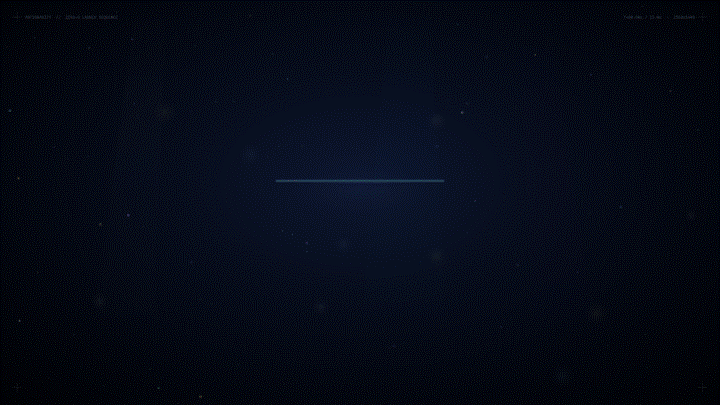
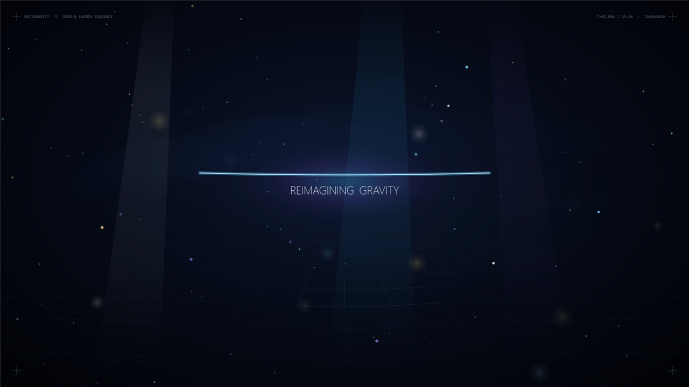
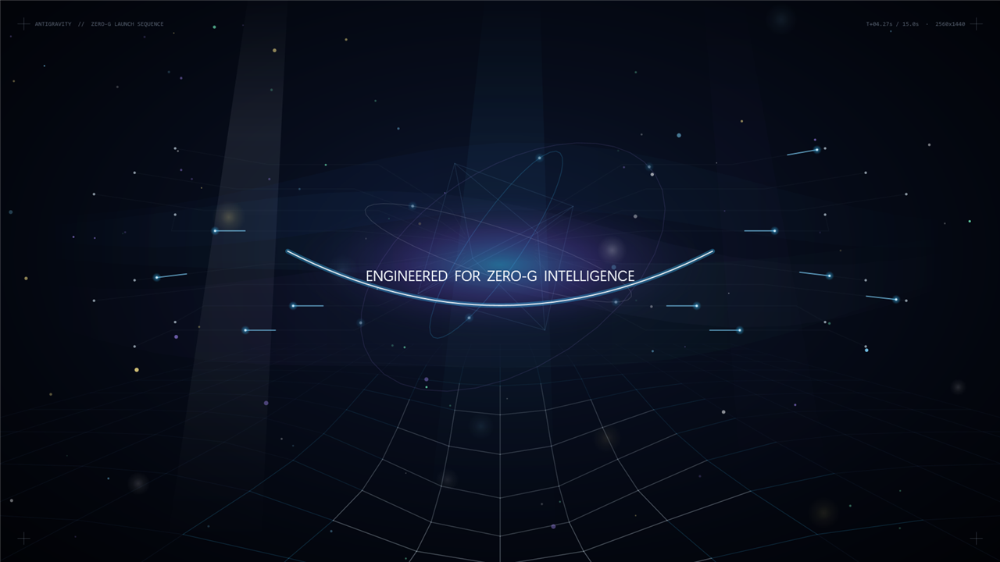
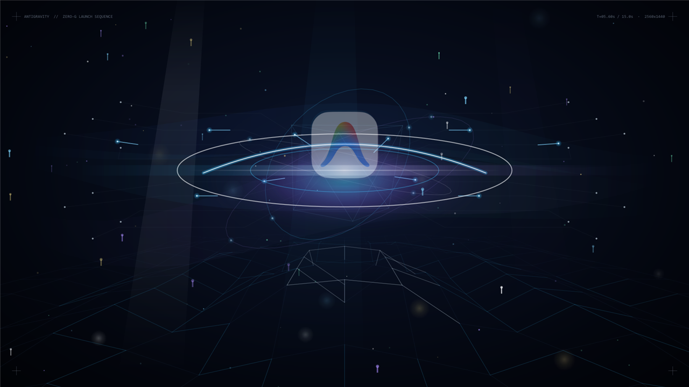
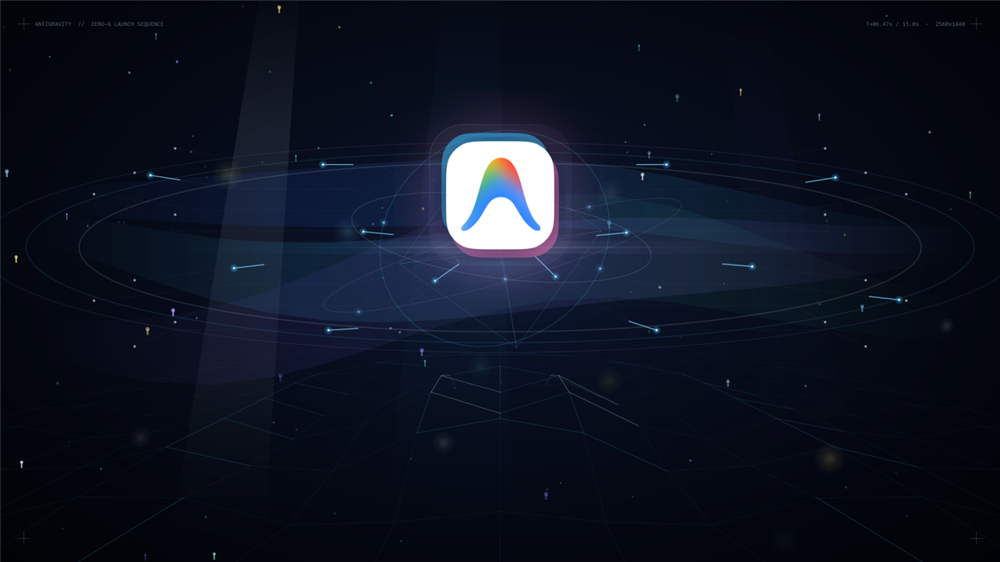
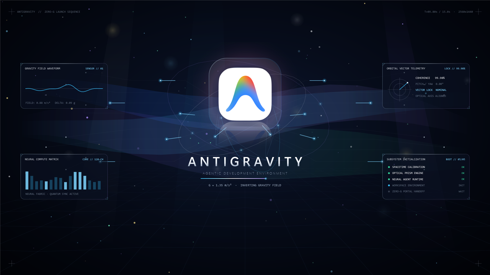
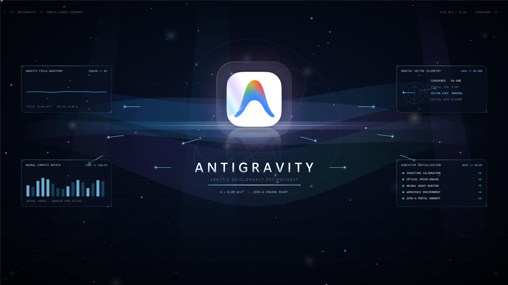
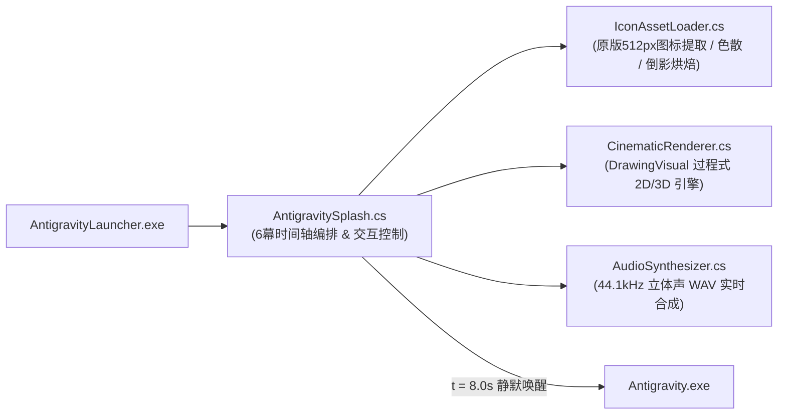

<div align="center">

# Antigravity Zero-G Splash Launcher

**为 Windows 版 Antigravity 打造的 15 秒全屏科幻电影级启动动画与零重力声效启动器**

*融合 Apple Keynote 影棚体积光影与 Microsoft Fluent / Copilot 深色毛玻璃空间 HUD 美学*

[](https://www.microsoft.com/windows)
[-512BD4?style=flat-square&logo=dotnet)](https://dotnet.microsoft.com/)
[](#快速开始)
[](https://github.com/gzmhandsomeman/antigravity-splash-launcher/actions/workflows/build.yml)
[](LICENSE)

[简体中文](README.md) | [English](README_EN.md)

<br />



</div>

---

## 项目简介

**Antigravity Zero-G Splash Launcher** 是一个零外部依赖的纯原生 Windows C# / WPF 启动包装器（单文件仅 ~115 KB）。当你通过桌面、任务栏或开始菜单启动 Antigravity 时，它会先以原生全屏（支持 2K / `PerMonitorV2` 高分屏自适应）播放一段 **15 秒六幕式「重力反转 → 零重力升空」科幻开启动画**，同时在后台静默拉起 `Antigravity.exe` 并在动画结束时平滑过渡进入主程序。

整个程序不依赖 Node.js、Electron、FFmpeg、DirectX SDK 或任何 NuGet 第三方包——仅靠 Windows 自带的 `.NET Framework 4.x` (`csc.exe`) 即可直接编译为独立可执行文件，连 **44.1 kHz 立体声电影感配乐** 都是纯数学波形实时合成的。

---

## 核心亮点

- **电影级混合视觉语言**：结合 **Apple Keynote** 影棚斜向体积光束、舞台镜像倒影、动态字距排印与 **Microsoft Fluent / Copilot** 深色透明玻璃态（Dark Glassmorphism）、多层流动极光光带及空间遥测 HUD。
- **自动提取原版官方图标**：编译时自动从本机 `app.asar` 中解析提取原版 `512×512` 官方 `icon.png` 并内嵌为 EXE 资源；若目标环境未安装 Antigravity（例如 CI 环境），自动回退至内置程序化棱镜图标。
- **100% 过程式矢量与 3D 渲染引擎**：
  - `17×13` 3D 透视时空曲率网格（先受重力下陷为重力井，随后瞬间反转弹起并扩散波纹）
  - 3 层同心 3D 陀螺仪星盘环 + 八面体空间晶格 + 绕轨光子微粒
  - 16 路对称 45° 倒角硅片总线与高速光脉冲数据包
  - 3 重交错 3D 冲击波环 + 宽银幕变形镜头光晕（Anamorphic Lens Flare）
  - 100 颗三景深零重力漂浮微粒与散景光斑（反转后自动带运动拖尾向上升空）
  - 4 块深色玻璃空间 HUD 面板（重力波形、16 通道计算频谱、轨道矢量雷达、5 项子系统启动自检）
- **纯数学合成 15 秒立体声配乐**：启用 `--sound` 时在后台线程生成 44.1 kHz 16-bit 双声道 WAV 音轨，涵盖低频重力铺底、反转瞬态冲击、Major-9th 极光音垫、遥测提示音及结尾玻璃谐振锁音。
- **高性能优化（`4.0 FPS → 47.5 FPS`）**：针对 2560×1440 高分屏消除逐帧 `dc.PushOpacity()` 离屏层分配，采用 16 级预冻结画刷/画笔查表、`FormattedText` 缓存与预烘焙舞台倒影，实现近 **12 倍** 帧率提升。
- **非侵入式快捷方式集成与一键还原**：支持单独替换或一键接管**桌面 / 任务栏 / 开始菜单**快捷方式，完整备份原 `.lnk` 文件，随时可无损还原；启动期间按 `Esc` / `Space` / `Enter` 可立即跳过动画。

---

## 六幕视觉分镜详解

| 第一幕：虚空重力井 (`0.0s – 3.3s`) | 第二幕：硅片汇聚与张力积蓄 (`3.3s – 5.4s`) |
| :---: | :---: |
|  |  |
| 影棚体积光束穿透深空暗场，`REIMAGINING GRAVITY` 缓缓浮现，水平引力光丝展开并拉弯 3D 时空网格。 | 16 路硅片总线点亮并输送高速光脉冲，3D 陀螺仪星盘与八面体晶格在中央蓄能，标语 `ENGINEERED FOR ZERO-G INTELLIGENCE` 聚焦。 |

| 第三幕：重力反转爆裂 (`5.45s – 6.2s`) | 第三幕尾声：棱镜色散与零重力升空 (`6.2s – 8.0s`) |
| :---: | :---: |
|  |  |
| `5.45s` 引力弦鞭打反转，3 重 3D 冲击波与变形镜头光晕全屏爆发，原版图标破井而出，微粒转为向上升空。 | 原版 `512×512` 图标伴随冰青（`#38BDF8`）与品红（`#F472B6`）色散重影阻尼弹起并完成首次镜面扫光校准。 |

| 第四幕：空间 HUD 全域上线 (`8.0s – 11.5s`) | 第五至六幕：锁音定格与平滑交接 (`11.5s – 15.0s`) |
| :---: | :---: |
|  |  |
| 4 块深色玻璃 HUD 面板滑入两侧，`ANTIGRAVITY` 主标题以动态压缩字距展开，遥测读数从 `9.81` 归零，后台静默拉起主程序。 | `11.45s` 二次虹彩高光扫过图标与 `G = 0.00 m/s²` 就绪提示，HUD 柔化退让至背景，最后在 `13.85s–15.0s` 优雅淡出交接给 Antigravity。 |

---

## 快速开始

### 环境要求

- **操作系统**：Windows 10 / Windows 11（64 位）
- **编译器**：Windows 系统内置 `.NET Framework 4.x` (`C:\Windows\Microsoft.NET\Framework64\v4.0.30319\csc.exe`)，**无需安装 Visual Studio 或 .NET SDK**
- **PowerShell**：Windows PowerShell 5.1 或 PowerShell 7+

### 1. 克隆并编译

```powershell
git clone https://github.com/gzmhandsomeman/antigravity-splash-launcher.git
cd antigravity-splash-launcher
powershell -ExecutionPolicy Bypass -File .\build.ps1
```

> [!TIP]
> 编译脚本默认会读取 `%LOCALAPPDATA%\Programs\antigravity\resources\app.asar` 并提取官方原版 `512×512` 图标。如果你的 Antigravity 安装在自定义路径，可传入参数：
> ```powershell
> powershell -ExecutionPolicy Bypass -File .\build.ps1 -AsarPath "D:\Apps\antigravity\resources\app.asar"
> ```

### 2. 立即全屏预览（不会重复启动 IDE）

```powershell
.\AntigravityLauncher.exe --preview --sound
```

### 3. 安装 / 替换快捷方式

```powershell
# 推荐：一键备份并接管桌面、任务栏固定图标、开始菜单三处快捷方式，同时开启立体声配乐
powershell -ExecutionPolicy Bypass -File .\install-shortcut.ps1 -All -Sound
```

仅创建独立的桌面预览快捷方式 `Antigravity (Zero-G).lnk`（不改动现有快捷方式）：

```powershell
powershell -ExecutionPolicy Bypass -File .\install-shortcut.ps1 -Sound
```

随时无损恢复所有原始快捷方式：

```powershell
powershell -ExecutionPolicy Bypass -File .\install-shortcut.ps1 -RestoreDefault
```

---

## 命令行参数与交互控制

### 启动器 CLI 参数

| 参数 | 说明 | 默认值 |
| :--- | :--- | :--- |
| `--preview` | 预览模式：只播放动画，**不启动** `Antigravity.exe`，开启底部交互快捷键提示 | 关闭 |
| `--sound` | 启用 15 秒程序化 44.1 kHz 立体声电影配乐 | 关闭 |
| `--fast` | 3 倍速播放（15 秒动画压缩至 5 秒完成） | `1.0x` |
| `--fullscreen` | 原生无边框全屏模式（支持 `PerMonitorV2` DPI 自适应） | **默认开启** |
| `--windowed` | 窗口预览卡片模式（`1120×640` 圆角悬浮窗，带外阴影） | 关闭 |
| `--target <path>` | 指定待拉起的目标主程序路径（默认 `%LOCALAPPDATA%\Programs\antigravity\Antigravity.exe`） | 自动探测 |
| `--capture <dir>` | 离线渲染导出 8 张全分辨率关键帧 PNG 到指定目录 | — |
| `--capture-gif <file>` | 离线渲染导出循环播放的 GIF 预览图（`720×405`） | — |
| `--bench <logfile>` | 全屏实时帧率基准测试模式（循环渲染第 4 幕高负载场景 2.5s 并输出 FPS 统计） | — |

> 注：未匹配上述标记的其余参数（例如工作区文件夹路径）会自动透传给 `Antigravity.exe`。

### 快捷键控制

| 模式 | 按键 | 功能 |
| :--- | :--- | :--- |
| **正常启动模式** | `Esc` / `Space` / `Enter` | 立即跳过剩余动画，若尚未拉起主程序则立即启动 `Antigravity.exe` 并关闭启动页 |
| **预览模式 (`--preview`)** | `Space` | 暂停 / 继续播放 |
| **预览模式 (`--preview`)** | `←` / `→` | 向后 / 向前逐秒精确定位画面（`-1.0s` / `+1.0s`） |
| **预览模式 (`--preview`)** | `R` | 从 `0.0s` 重新播放动画与配乐 |
| **预览模式 (`--preview`)** | `Esc` | 退出预览 |

---

## 架构与性能优化实践

### 系统架构



### 模块说明

| 文件 | 职责说明 |
| :--- | :--- |
| [`AntigravitySplash.cs`](AntigravitySplash.cs) | 主应用入口、CLI 解析、DPI 感知全屏窗口管理、15 秒 6 幕时间轴插值、主程序拉起与截图/基准工具 |
| [`CinematicRenderer.cs`](CinematicRenderer.cs) | 基于 `DrawingVisual` 的无分配过程式渲染器（体积光、极光、3D 网格、陀螺仪、硅片脉冲、冲击波、HUD、Chrome） |
| [`IconAssetLoader.cs`](IconAssetLoader.cs) | 多级图标加载（内嵌资源 → 本地 PNG → EXE `RT_ICON` → 程序化备用棱镜图标）、色散幽灵生成与舞台倒影烘焙 |
| [`AudioSynthesizer.cs`](AudioSynthesizer.cs) | 纯 C# 内存 PCM 立体声合成器（低频无人机音、反转 Drop、Major-9th 音垫、晶莹提示音与谐振铃音） |
| [`app.manifest`](app.manifest) | 声明 Windows 10/11 兼容性与 `PerMonitorV2` 高 DPI 感知 |
| [`build.ps1`](build.ps1) | 自动从 `app.asar` 解包图标并调用系统 `csc.exe` 零依赖编译 |
| [`install-shortcut.ps1`](install-shortcut.ps1) | 桌面、任务栏、开始菜单快捷方式一键备份、安装与恢复脚本 |

### 2K 全屏性能调优历程（`4.0 FPS → 47.5 FPS`）

在双显卡笔记本的 `2560×1440` (`AllowsTransparency = true` + `PerMonitorV2`) 全屏分层窗口环境下，初版实现曾出现明显掉帧。通过逐层基准剖析定位并完成了以下关键优化（均在第 4 幕全元素开启的最重负载下通过 `--bench` 实测）：

| 优化阶段 | 实测帧率 | 单帧耗时 | 核心瓶颈与改进 |
| :--- | :---: | :---: | :--- |
| **初版全屏渲染** | `4.0 FPS` | `248.9 ms` | 每帧调用 200+ 次 `dc.PushOpacity()` 强制 WPF 分配临时透明合成层，且逐帧重建 `FormattedText` |
| **16 级透明度查表 + 文本缓存** | `39.3 FPS` | `25.5 ms` | 彻底移除全部 `dc.PushOpacity()`，改用预冻结 16 级 Alpha 画刷/画笔查表；缓存静态文本与几何；消除全屏颗粒纹理过绘 |
| **去 Shader + 预烘焙倒影** | **`47.5 FPS`** | **`21.1 ms`** | 启动时在 `IconAssetLoader` 预烘焙图标倒影替代动态 `OpacityMask`；用径向渐变椭圆替代 `DropShadowEffect`；移除 `BlurEffect` 与冗余圆角绘制，C# CPU 逻辑耗时仅 `0.95 ms` |

> [!NOTE]
> 为规避部分 Intel + NVIDIA 双显卡笔记本上 WPF `AllowsTransparency = false` 全屏 D3D9 窗口出现黑屏的驱动兼容问题，全屏模式默认采用稳定可见的透明分层合成管线。

---

## 项目结构

```text
antigravity-splash-launcher/
├── .github/
│   └── workflows/
│       └── build.yml               # GitHub Actions Windows 自动编译验证
├── assets/                         # README 展示动图与六幕高清截图
│   ├── preview.gif
│   ├── act1_void_prologue.png
│   ├── act2_silicon_convergence.png
│   ├── act3_inversion_burst.png
│   ├── act3_icon_dispersion.png
│   ├── act4_hud_online.png
│   └── act5_hero_lockin.png
├── AntigravitySplash.cs            # 启动器主程序与时间轴编排
├── CinematicRenderer.cs            # 过程式 2D/3D 图形与 HUD 渲染引擎
├── IconAssetLoader.cs              # 图标提取、色散与倒影预处理
├── AudioSynthesizer.cs             # 15s 立体声配乐波形合成器
├── app.manifest                    # PerMonitorV2 DPI 与系统兼容性清单
├── build.ps1                       # 零依赖编译脚本
├── install-shortcut.ps1            # 快捷方式安装与备份还原脚本
├── CHANGELOG.md                    # 版本更新记录
├── CONTRIBUTING.md                 # 贡献指南
├── LICENSE                         # MIT 开源协议
├── README.md                       # 中文说明文档
└── README_EN.md                    # 英文说明文档
```

---

## 自定义说明

- **修改动画总时长**：调整 `AntigravitySplash.cs` 中的 `TotalDuration`（默认 `15.0` 秒），并同步参考关键幕时间戳。
- **修改延迟拉起主程序时机**：在 `AntigravitySplash.cs` 的 `OnCompositionRendering` 中调整 `t >= 8.0` 阈值（越早拉起，动画结束时主程序越快就绪）。
- **使用自定义图标**：将任意正方形 PNG 放至项目根目录并命名为 `antigravity-icon.png`，或在编译时传入 `-IconPath "your-icon.png"`。

---

## 常见问题

<details>
<summary><b>1. 运行 PowerShell 脚本提示「在此系统上禁止运行脚本」怎么办？</b></summary>

使用带 `-ExecutionPolicy Bypass` 的命令执行即可，不会永久更改系统安全策略：
```powershell
powershell -ExecutionPolicy Bypass -File .\build.ps1
```
</details>

<details>
<summary><b>2. 我把 Antigravity 固定在任务栏，为什么替换桌面后点任务栏图标还是没动画？</b></summary>

Windows 任务栏会在 `%APPDATA%\Microsoft\Internet Explorer\Quick Launch\User Pinned\TaskBar\` 中保存独立的 `.lnk` 副本。请使用 `-Taskbar` 或 `-All` 参数运行安装脚本：
```powershell
powershell -ExecutionPolicy Bypass -File .\install-shortcut.ps1 -All -Sound
```
若 Windows 资源管理器缓存了旧图标目标，右键**从任务栏取消固定**后重新将桌面图标固定到任务栏即可立即生效。
</details>

<details>
<summary><b>3. 提示找不到 `Antigravity.exe` 或动画结束没打开主程序？</b></summary>

如果软件未安装在默认的 `%LOCALAPPDATA%\Programs\antigravity\Antigravity.exe`，可在安装快捷方式时通过 `-TargetExe` 指定实际路径：
```powershell
powershell -ExecutionPolicy Bypass -File .\install-shortcut.ps1 -All -Sound -TargetExe "D:\Programs\antigravity\Antigravity.exe"
```
</details>

---

## 免责声明与开源协议

- 本项目为第三方开源桌面启动美化工具，仅用于增强本地启动视觉与听觉体验；代码不包含任何官方二进制或受版权保护的图标文件（仓库内置图标仅为本地编译无原版环境时的程序化几何备用图形）。
- 基于 [MIT License](LICENSE) 开源发布。
