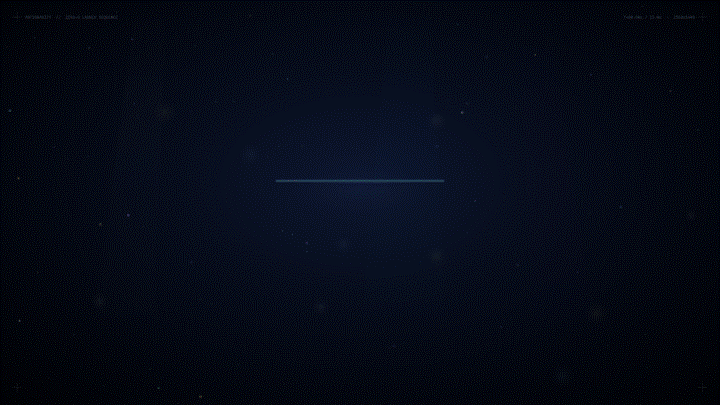
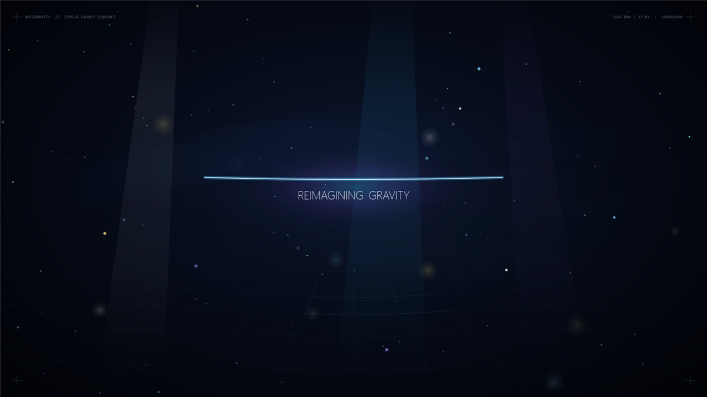
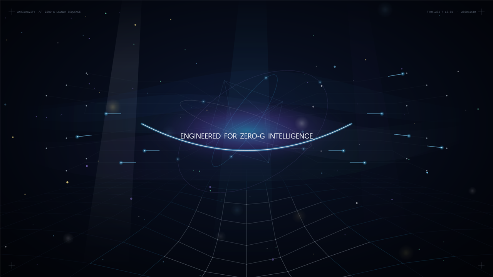
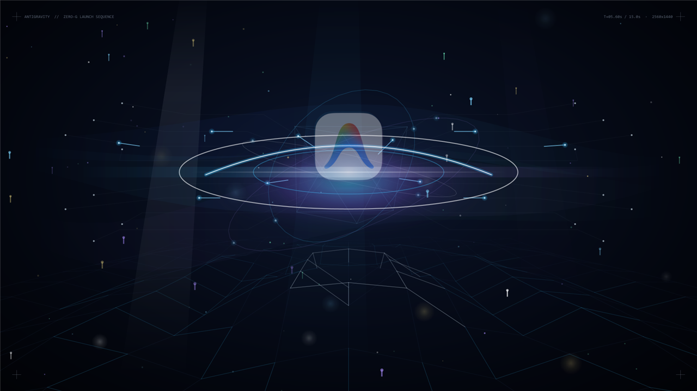
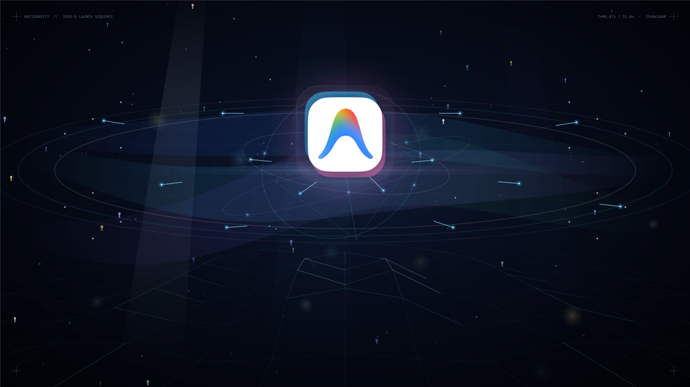
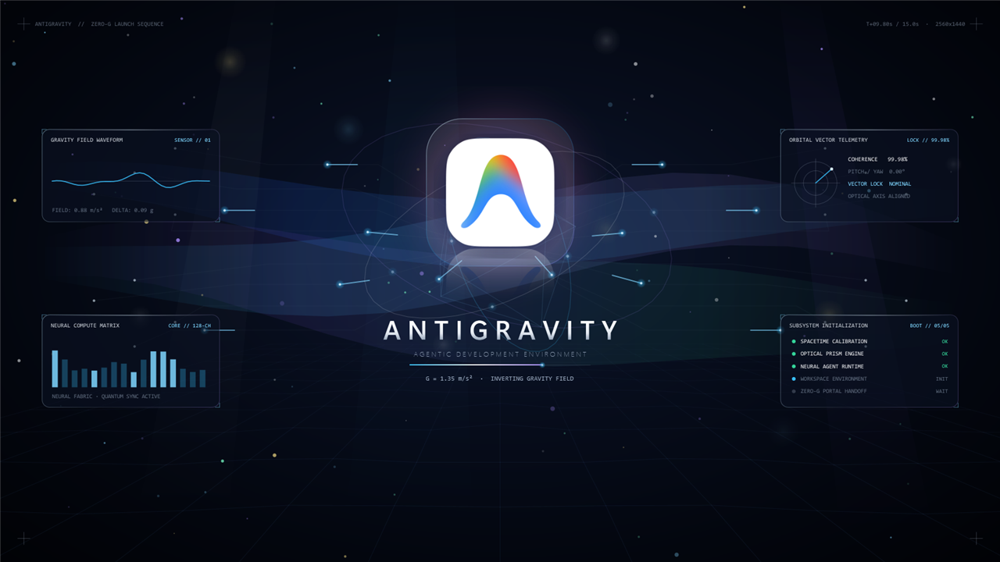
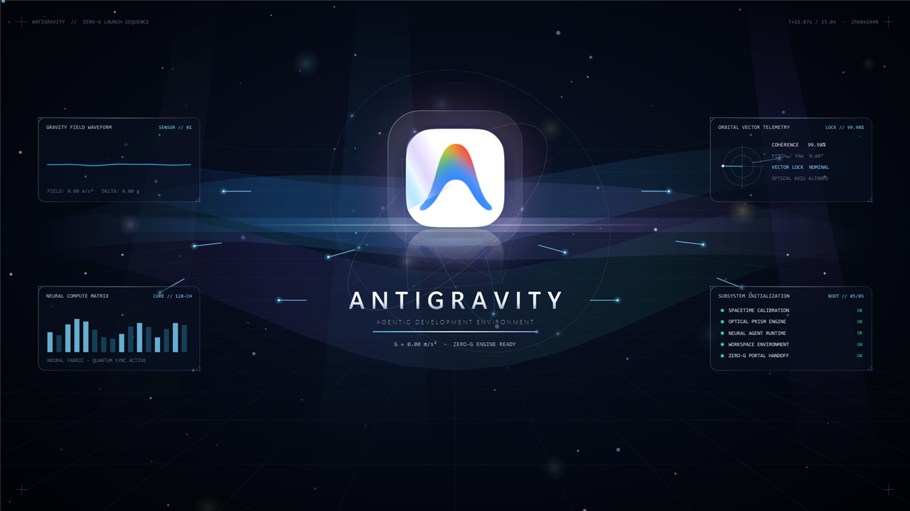
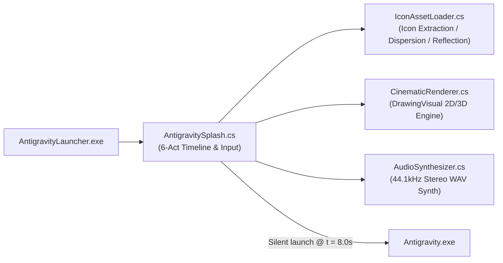

<div align="center">

# Antigravity Zero-G Splash Launcher

**A 15-second fullscreen Apple Keynote × Microsoft Fluent style Zero-G cinematic splash launcher for Antigravity on Windows**

*Zero external dependencies · Pure C# / WPF · Procedural 2D/3D visuals · Synthesized 44.1 kHz stereo score*

[](https://www.microsoft.com/windows)
[-512BD4?style=flat-square&logo=dotnet)](https://dotnet.microsoft.com/)
[](#quick-start)
[](https://github.com/gzmhandsomeman/antigravity-splash-launcher/actions/workflows/build.yml)
[](LICENSE)

[简体中文](README.md) | [English](README_EN.md)

<br />



</div>

---

## Overview

**Antigravity Zero-G Splash Launcher** is a lightweight (~115 KB single-executable), zero-dependency native Windows C# / WPF launcher wrapper for Antigravity. When you launch Antigravity from your Desktop, Taskbar, or Start Menu, it plays a **15-second, 6-act fullscreen "Gravity Inversion → Zero-G Ascent" cinematic sequence** (with native 2K / `PerMonitorV2` DPI scaling) while silently warming up `Antigravity.exe` in the background for a seamless handoff.

It requires **zero** external runtimes or packages (no Node.js, Electron, FFmpeg, DirectX SDK, or NuGet) — it compiles directly using the built-in Windows `.NET Framework 4.x` compiler (`csc.exe`) and synthesizes its **44.1 kHz stereo soundtrack** purely in memory.

---

## Key Highlights

- **Apple Keynote × Microsoft Fluent Visual Language**: Combines studio volumetric light shafts, floor specular reflections, and kinetic tracking typography with dark glassmorphism HUD cards, multi-layered flowing aurora ribbons, and spatial telemetry.
- **Authentic Original Icon Extraction**: Automatically extracts the original `512×512` `icon.png` from your local Antigravity `app.asar` at build time and embeds it into `AntigravityLauncher.exe` (with a clean procedural fallback prism icon when compiled in CI or environments without Antigravity installed).
- **100% Procedural 2D/3D Rendering Engine**:
  - `17×13` 3D perspective spacetime curvature mesh (dips into a gravity well before snapping upward into an anti-gravity ripple at `5.45s`)
  - 3 concentric 3D gyroscopic astrolabe rings + octahedral polyhedral lattice + orbiting photon nodes
  - 16 symmetrical 45°-chamfered silicon circuit traces with traveling light-packet pulses
  - Triple staggered 3D shockwaves + full-width anamorphic cinema lens flare
  - 100 three-depth zero-G particles & bokeh dust (reversing into upward motion-streaked ascent)
  - 4 dark-glass spatial HUD telemetry panels (gravity waveform, 16-channel neural compute matrix, orbital vector radar, 5-stage subsystem boot checklist)
- **Procedural 15s Stereo Score (`--sound`)**: Synthesized asynchronously in memory at 44.1 kHz 16-bit stereo — sub-bass gravitational drone, inversion drop, Major-9th ambient synth pad, crystalline telemetry pings, and final harmonic glass lock-in chime.
- **High-FPS Optimization (`4.0 FPS → 47.5 FPS`)**: Eliminated 200+ per-frame `dc.PushOpacity()` offscreen layer allocations in favor of pre-frozen 16-step alpha-bucketed brush/pen tables, cached `FormattedText`, and pre-baked reflection bitmaps (~12× speedup at native 2560×1440).
- **Safe Shortcut Management & Instant Skip**: Backs up and updates Desktop, Taskbar, and Start Menu shortcuts with one-command restoration (`-RestoreDefault`); press `Esc`, `Space`, or `Enter` anytime during playback to skip straight to Antigravity.

---

## 6-Act Visual Storyboard

| Act 1: Void & Gravity Well (`0.0s – 3.3s`) | Act 2: Silicon Convergence (`3.3s – 5.4s`) |
| :---: | :---: |
|  |  |
| Studio volumetric shafts pierce the obsidian void as `REIMAGINING GRAVITY` fades in and the horizontal filament bends the spacetime mesh. | 16 silicon bus traces carry luminous pulses while the 3D gyroscopic astrolabe charges up behind `ENGINEERED FOR ZERO-G INTELLIGENCE`. |

| Act 3: Gravity Inversion Burst (`5.45s – 6.2s`) | Act 3 Finale: Chromatic Dispersion (`6.2s – 8.0s`) |
| :---: | :---: |
|  |  |
| At `5.45s`, the filament snaps upward, unleashing triple 3D shockwaves, anamorphic lens flare, and upward particle reversal. | The original `512×512` Antigravity icon rises with damped spring physics and cyan/magenta optical dispersion before locking in. |

| Act 4: Spatial HUD Online (`8.0s – 11.5s`) | Acts 5–6: Specular Lock-In & Handoff (`11.5s – 15.0s`) |
| :---: | :---: |
|  |  |
| 4 dark-glass HUD panels slide onto the flanks, `ANTIGRAVITY` reveals with compressing glyph tracking, and `Antigravity.exe` warms up silently. | A second iridescent sheen sweeps across the icon as `G = 0.00 m/s²` locks in, HUD cards softly dim, and the screen fades smoothly into Antigravity. |

---

## Quick Start

### Prerequisites

- **OS**: Windows 10 / Windows 11 (x64)
- **Compiler**: Built-in Windows `.NET Framework 4.x` (`C:\Windows\Microsoft.NET\Framework64\v4.0.30319\csc.exe`) — **no Visual Studio or .NET SDK needed**

### 1. Clone & Build

```powershell
git clone https://github.com/gzmhandsomeman/antigravity-splash-launcher.git
cd antigravity-splash-launcher
powershell -ExecutionPolicy Bypass -File .\build.ps1
```

> [!TIP]
> `build.ps1` automatically extracts the official `512×512` icon from `%LOCALAPPDATA%\Programs\antigravity\resources\app.asar`. Pass `-AsarPath` or `-IconPath` if installed elsewhere.

### 2. Fullscreen Interactive Preview

```powershell
.\AntigravityLauncher.exe --preview --sound
```

### 3. Install / Restore Shortcuts

```powershell
# Back up and update Desktop, Taskbar, and Start Menu shortcuts with sound enabled
powershell -ExecutionPolicy Bypass -File .\install-shortcut.ps1 -All -Sound

# Or create a standalone Desktop shortcut without touching defaults
powershell -ExecutionPolicy Bypass -File .\install-shortcut.ps1 -Sound

# Restore all original backed-up shortcuts anytime
powershell -ExecutionPolicy Bypass -File .\install-shortcut.ps1 -RestoreDefault
```

---

## CLI Options & Controls

### Command-Line Flags

| Flag | Description | Default |
| :--- | :--- | :--- |
| `--preview` | Play animation only without launching `Antigravity.exe`; enables playback controls | Off |
| `--sound` | Play synthesized 15-second 44.1 kHz stereo soundtrack | Off |
| `--fast` | 3× playback speed (finishes in 5.0 seconds) | `1.0x` |
| `--fullscreen` | Borderless fullscreen mode with `PerMonitorV2` DPI scaling | **On** |
| `--windowed` | Floating `1120×640` rounded-card preview window | Off |
| `--target <path>` | Custom path to target `Antigravity.exe` | Auto-detected |
| `--capture <dir>` | Render and export 8 full-resolution keyframe PNGs | — |
| `--capture-gif <file>` | Render and export a looping `720×405` animated GIF | — |
| `--bench <logfile>` | Run live fullscreen FPS benchmark (Act 4 heavy load) and write metrics | — |

### Keyboard Shortcuts

| Mode | Key | Action |
| :--- | :--- | :--- |
| **Normal Launch** | `Esc` / `Space` / `Enter` | Skip animation immediately and launch `Antigravity.exe` |
| **Preview (`--preview`)** | `Space` | Pause / resume playback |
| **Preview (`--preview`)** | `←` / `→` | Scrub backward / forward by `1.0s` |
| **Preview (`--preview`)** | `R` | Restart animation and audio from `0.0s` |
| **Preview (`--preview`)** | `Esc` | Close preview |

---

## Architecture & Performance Engineering



### Benchmark Summary (2560×1440 Native Fullscreen, Act 4 Worst-Case)

| Stage | Measured FPS | Avg Frame Time | Key Optimization |
| :--- | :---: | :---: | :--- |
| Initial Fullscreen Build | `4.0 FPS` | `248.9 ms` | 200+ `dc.PushOpacity()` calls/frame + per-frame `FormattedText` allocations |
| Alpha-Bucketed Brushes & Cached Text | `39.3 FPS` | `25.5 ms` | Replaced all `dc.PushOpacity()` with 16-step frozen brush/pen tables; cached `FormattedText`; batched circuits |
| Shader Removal & Pre-Baked Reflection | **`47.5 FPS`** | **`21.1 ms`** | Pre-baked icon floor reflection bitmap; replaced `BlurEffect` & `DropShadowEffect`; `AvgCpuMs = 0.95 ms` |

---

## License & Disclaimer

- Released under the [MIT License](LICENSE).
- Unofficial third-party launcher wrapper for personal desktop customization. This repository does not redistribute any proprietary binaries or icons.
